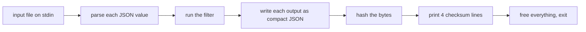

# A jq core in Goose, against jq and jaq

For the filters it supports, a small jq in Goose is faster than both. It has a JSON reader and
writer, a parser for part of the jq language, and an evaluator. On one hour of real GitHub events,
it is 1.7 to 5.8 times faster than jaq and 2.1 to 4.0 times faster than jq. On jaq's own benchmark
filters, it is fastest on 13 of 14. jaq wins the one deep-recursion filter, by 11 times. All three
programs give the same output, byte for byte, in every case.

Most of the win comes from a design that an expert C programmer can also write by hand: all values
of one input in one memory pool, freed in one step, with numbers and short values stored inline.
Goose makes that design the easy one, and keeps it memory-safe. The same design is also Goose's weak
point. A value cannot change after it is built, so filters that grow an array step by step use time
and memory that grow with the square of the size.

Numbers: `scripts/bench.py`, in [results/bench-table.md](results/bench-table.md).

## The question

Goose claims its largest wins on parse trees, interpreters and string-keyed tables. A jq is all
three. So: if we write the core of jq in Goose, how does it compare with jq itself (the usual C
implementation) and with jaq (a fast Rust rewrite)?

## How we measured



- **Three rows, one harness.** Each row reads standard input, runs one filter on each value, writes
  each output as compact JSON, and folds the bytes into one hash. Each prints the same four lines:
  inputs, outputs, bytes and the hash. The run stops if any line differs from jq's.
- **jq row (idiomatic):** jq 1.8.2, built from its release file with gcc -O2, used as a library
  ([baselines/harness_jq.c](baselines/harness_jq.c)).
- **jaq row (expert):** jaq at commit `6b8cbeb`, built with `cargo build --release`, used as a library,
  with the allocator the jaq command uses (mimalloc) ([baselines/harness_jaq/](baselines/harness_jaq/)).
- **Goose row:** [goose/jqg.goose](goose/jqg.goose), about 1,800 lines, compiled by Goose at commit
  `0e04966` to C, then by gcc -O2.
- **Two check rows:** the jq and jaq commands themselves. The jaq command is as fast as our jaq row.
  The jq command is slower than our jq row (13.0 s against 8.1 s on the largest input), because it
  prints through a slower path. So our jq row is the faster of the two jq choices.
- **Timing:** 1 warm-up run and 5 timed runs per row, the rows in turn, the median wall time. The
  spread of the 5 runs is 6% or less for most rows. The worst cells are one Goose run on the 31 MB
  re-emit (25%) and the jq command's `reverse` runs (22%); their medians do not change. Peak memory is
  from `/usr/bin/time` ([scripts/rss.py](scripts/rss.py)). More: [../machine.md](../machine.md).

## The inputs

- **Real data:** one hour of public GitHub events from GH Archive (2024-01-15, 15:00), cut at line
  boundaries into three files: 1.1 MB (291 events), 31 MB (8,677 events) and 315 MB (84,850 events).
- **Three real filters:** `.` (read and write again), a select that builds a small object for each
  push event, and a walk that adds up the length of every string.
- **jaq's own benchmarks:** the filters from jaq's README, at three sizes each. The large size is the
  size in jaq's table. We use the 14 filters that our Goose subset can run, plus `empty`, which
  measures start-up.
- **Generated data:** the same three filters over output of [inputs/gen_events.py](inputs/gen_events.py),
  at 1.0 MB, 31 MB and 316 MB.

[inputs/fetch.sh](inputs/fetch.sh) makes every file, with the same bytes as ours
([inputs/sha256.txt](inputs/sha256.txt)).

## Results: real GitHub data

Command: `scripts/bench.py` ([results/bench.json](results/bench.json), table
[results/bench-table.md](results/bench-table.md)); peak memory from `scripts/rss.py`.

| filter | size | jq | jaq | Goose | jq / Goose | jaq / Goose |
|---|---|---:|---:|---:|---:|---:|
| `.` | 1 MB | 30 ms | 19 ms | 11 ms | 2.7x | 1.7x |
| | 315 MB | 8.08 s | 4.89 s | 2.80 s | 2.9x | 1.8x |
| select, build object | 1 MB | 16 ms | 14 ms | 8 ms | 2.1x | 1.8x |
| | 315 MB | 4.07 s | 3.48 s | 1.95 s | 2.1x | 1.8x |
| sum of string lengths | 1 MB | 35 ms | 49 ms | 10 ms | 3.5x | 4.9x |
| | 315 MB | 9.44 s | 13.81 s | 2.38 s | 4.0x | 5.8x |

The middle size (31 MB) gives the same ratios. Peak memory on the 315 MB file is 2.1 to 2.4 MB for
Goose, 2.7 to 3.0 MB for jq and 17 to 20 MB for jaq. All three read the input as a stream.

The generated input gives the same picture. On 316 MB of generated events, jaq / Goose is 1.8x, 1.9x
and 6.1x, and jq / Goose is 2.9x, 2.1x and 4.0x ([results/bench-gen.log](results/bench-gen.log)).

## Results: jaq's own benchmarks, large size

Same command. The size n is the one in jaq's README.

| filter | n | jq | jaq | Goose | jaq / Goose | peak memory jq / jaq / Goose |
|---|---:|---:|---:|---:|---:|---|
| `reverse` | 1,048,576 | 636 ms | 96 ms | 46 ms | 2.1x | 84 / 49 / 36 MB |
| `sort` | 1,048,576 | 594 ms | 172 ms | 67 ms | 2.6x | 87 / 53 / 46 MB |
| `group-by` | 1,048,576 | 1,697 ms | 333 ms | 192 ms | 1.7x | 143 / 167 / 72 MB |
| `min-max` | 1,048,576 | 196 ms | 170 ms | 48 ms | 3.6x | 35 / 71 / 20 MB |
| `add` | 1,048,576 | 743 ms | 479 ms | 96 ms | 5.0x | 131 / 153 / 56 MB |
| `kv` | 131,072 | 185 ms | 142 ms | 39 ms | 3.6x | 74 / 63 / 20 MB |
| `cumsum` | 1,048,576 | 534 ms | 353 ms | 117 ms | 3.0x | 64 / 65 / 41 MB |
| `cumsum-xy` | 1,048,576 | 811 ms | 564 ms | 166 ms | 3.4x | 120 / 107 / 66 MB |
| `last` | 1,048,576 | 120 ms | 28 ms | 6 ms | 4.9x | 2 / 9 / 11 MB |
| `to-fromjson` | 65,536 | 391 ms | 67 ms | 11 ms | 5.9x | 15 / 25 / 6 MB |
| `ack` | 7 | 507 ms | 537 ms | 114 ms | 4.7x | 3 / 125 / 2 MB |
| `upto` | 8,192 | 432 ms | 7 ms | 78 ms | **0.09x** | 4 / 13 / 7 MB |
| `str-slice` | 8,192 | 1,388 ms | 346 ms | 207 ms | 1.7x | 135 / 211 / 130 MB |
| `range-prop` | 128 | 253 ms | 394 ms | 47 ms | 8.4x | 5 / 16 / 9 MB |
| `empty` (start-up) | 1 | 2 ms | 2 ms | 1 ms | same | 3 / 9 / 2 MB |

The small and middle sizes, in the same table file, give the same order. Start-up is a larger part of
the small runs.

## Where the time goes

Command: `scripts/profile.sh` (`perf record`), output in [results/profile/](results/profile/). The
profiles are of the first Goose version, [goose/jqg_match.goose](goose/jqg_match.goose). It differs
from the final one only in how the evaluator picks the code for each kind of syntax node.

- **jq** spends its time in its parser (24 to 52% on the GitHub files), in checks that each string is
  valid UTF-8 (about 25% when it writes the data again), and on large filters in its bytecode machine:
  its stacks and frames (up to 65% on `ack`). Each value has a reference count, and each string and
  object is its own allocation, so freeing (`jv_free`) is 7 to 13%.
- **jaq** spends its time in its JSON reader (22 to 35% on the GitHub files) and in its evaluator.
  Each filter step makes small boxed iterators and reference-counted values, so allocating and
  freeing is 17 to 21% of the time on the string walk and on `ack`.
- **Goose** spends 41 to 61% of its time on the GitHub files only reading lines. Goose's standard
  library reads standard input one byte at a time. With all of the input read at once instead, the
  Goose row is 1.6x to 2.4x faster again ([results/bench-extra.log](results/bench-extra.log): 315 MB
  select, 1.97 s to 0.83 s). The tables above do not use that number, because it keeps the whole
  input in memory. The rest of the Goose time is the string scan, the parser and the writer. It does
  not allocate or free anywhere.

## What it means

**The design gives the win.** Three choices do the work, and the profiles show each one:

- **One pool per input, freed in one step.** Every string, array and object of one input goes into
  one pool. When the input is done, the pool is reset. jq and jaq free each value through a reference
  count.
- **Small values inline.** A number, true, false and null live in a 9-byte cell, not in an
  allocation. A string's bytes, an array's cells and an object's keys sit inside the value itself.
- **An eager evaluator.** Each filter step puts all its outputs on one stack. jq runs a backtracking
  bytecode machine, and jaq builds a chain of iterators.

**Goose's part is that this design is the default.** In Goose, the pool, the inline strings and the
4-byte links are the normal way to write the code, and every access is bounds-checked. The program
has no `malloc`, no `free` and no reference count. An expert C programmer can write the same design
with an arena and a tagged union, and should get the same speed. So the result shows what the Goose
style gives for an interpreter. It does not show that C cannot do it.

**The weak points are real.** They are the cost of the same design:

- **Deep recursion.** `upto` recurses 8,192 levels. The eager evaluator moves the outputs of each
  level down the stack again, so the time grows with the square of the depth. 93% of the Goose time
  on `upto` is that move. jaq is 11 times faster here.
- **Values that grow.** jaq's `reduce` benchmark adds one item to an array at each step. jq and jaq
  change the array in place. A Goose value cannot change after it is built, so each step copies the
  whole array, and the pool keeps every copy until the input ends. At n = 16,384 the Goose row takes
  0.57 s and 1.2 GB, where jq takes 0.01 s and 3 MB. At n = 65,536 it stops, because its 2 GB data
  stack is full. That filter is not in the table. The same cause rules out update filters (`|=`, `+=`).
- **A subset.** Our Goose jq has no `try`, no `limit` or other endless generators, no paths, no update
  assignment, no string interpolation and no filter parameters. jaq has 30 benchmarks, and 15 are not
  in our table: 12 need one of these features, `reduce` grows an array (above), `pyramid` recurses
  524,288 levels, and we did not try `defs`. A full jq would be slower than ours where it needs them.
  jq and jaq also pay for features we do not use, for example error values on every step.

**Two things we checked, because they could explain the gap. They do not:**

- jq keeps number literals exactly as written. A jq built without that feature (`--disable-decnum`) is
  the same speed, within 1% ([results/bench-nodec.log](results/bench-nodec.log)).
- The first Goose version did not check UTF-8. We added the check before the final runs. It costs less
  than the noise.

## Two findings for Goose

- **A compiler bug.** A case function that takes a variant with no fields by value, inside a
  recursive cycle, passes `goose check` but `goose build` stops with an internal error. The 12-line
  example is [goose/repro/casefn_zero_size_variant.goose](goose/repro/casefn_zero_size_variant.goose).
  Taking the variant by reference works around it.
- **A slow line reader.** The standard library reads lines one byte at a time
  (`src/runtime/runtime_os.h`, `gs_os_read_line`). In this benchmark that is 40% or more of the Goose
  time.

## How this could become a row in Goose's suite

- **Files:** the Goose row (`bench/goose/jq.goose`, from `goose/jqg.goose`), the jq row as a small C
  program over libjq, the jaq row as a small Rust program over jaq's library, a script that builds
  jq 1.8.2 and jaq at a fixed commit, and the input generator. No jq or jaq source goes into Goose's
  repository.
- **The suite's runner:** jaq's filters take one number as input, so they fit the suite's three sizes
  as they are. The event filters need an input file made before the rows run, and a filter text. The
  four checksum lines fit the suite's check.
- **The generator:** GitHub data cannot go into the repository, so `gen_events.py` makes events of the
  same shape: the same mix of event types, the same keys, nested users and repositories, escapes and
  UTF-8 text. It gives about 2.6 KB per event, where the real data has 3.7 KB. Its timings are within
  11% of the real ones.
- **Licenses:** Goose is Apache-2.0. jq is MIT, with the dtoa notice and decNumber's ICU license; its
  regular-expression library, Oniguruma, is BSD-2-Clause. jaq is MIT.

## Run it

From the repository root:

```bash
bin/build-all jq                      # jq 1.8.2, jaq, the harnesses, the Goose row (EXTRA=1: jq without decNumber)
bin/fetch-inputs --size small jq      # gh-s and gen-s; jaq's filters need no file
jq/scripts/run.sh small               # time, memory, table; into .out/jq/results/
```

## Files

| path | what |
|---|---|
| `goose/jqg.goose`, `goose/jqg.c` | the Goose row and its generated C ([goose/GENERATED.md](goose/GENERATED.md)) |
| `goose/jqg_match.goose`, `goose/jqg_match.c` | the first version, with one `match` in the evaluator (the profiles and `results/bench-v1-*`) |
| `goose/repro/` | the compiler bug, in 12 lines |
| `baselines/harness_jq.c`, `baselines/harness_jaq/` | the jq and jaq rows |
| `inputs/` | the generator, the fetch recipe and the sums |
| `scripts/` | `build.sh`, `run.sh`, `bench.py`, `rss.py`, `table.py`, `profile.sh` |
| `results/` | `bench.json` and its table, the generated-input, extra and no-decNumber runs, the first version's run, profiles, build logs |
