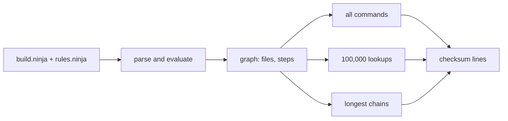

# Loading a Ninja build graph: Ninja, n2 and Goose

Goose loads a real build file faster than Ninja and faster than n2, at every size we tried. On LLVM's
build file (139 MB), the load and the fixed work take 0.60 s in Goose, 0.75 s in n2 and 0.88 s in
Ninja. So Goose is 1.48 times faster than Ninja and 1.26 times faster than n2. It also uses less
memory: 170 MB, against 231 MB for n2 and 262 MB for Ninja.

All three programs run about the same number of instructions. Goose is faster because it touches
less memory: it has about one quarter of Ninja's level 1 cache misses. An expert C programmer can
get the same layout by hand. In Goose it is the ordinary way to write the program.

Numbers: `scripts/bench.py --mode full`, in [results/bench-full.md](results/bench-full.md).

## The question

Ninja is the build tool that CMake, Meson and GN write files for. Before Ninja can start a build, it
reads `build.ninja` and makes a graph of files and build steps. For a large project the file has
hundreds of megabytes, and this load runs each time a developer types `ninja`. n2 is a rewrite of
Ninja in Rust by Ninja's first author, made to load faster.

The three rows:

- **Idiomatic: Ninja itself.** It makes one C++ object per file and per build step, copies each
  string, and keeps the files in a hash map.
- **Expert: n2.** It keeps files and steps in arrays with 32-bit ids, and uses a fast hash map and
  the jemalloc allocator.
- **Goose: a new loader, [goose/ninja_load.goose](goose/ninja_load.goose).** It keeps the whole file
  in one buffer. A path with no `$` in it is a view of that buffer, so it is not copied. The graph
  lives in four pools, linked by 4-byte references.

The Ninja row links our harness, [baselines/ninja_harness.cc](baselines/ninja_harness.cc), with
Ninja's own parser and graph objects. The n2 row, [baselines/n2_harness/](baselines/n2_harness/),
calls n2's own loader.

## The work

Each program does the same work and prints the same seven checksum lines. The run stops if one line
differs.

1. Load `build.ninja` and the file it includes.
2. Count the files, the build steps, their inputs and outputs, and hash every file path. The hash
   shows that all three programs clean up paths (`a/./b`, `a/../b`) the same way.
3. Make the full command line of every build step, and count and hash those commands.
4. Do 100,000 lookups: pick a build step at random, look up its output by name, and count that
   file's inputs and its users.
5. For each file, find the longest chain of build steps below it.
6. Free everything.



A "load only" mode stops after step 1. Ninja's own `ninja -t query all` takes 0.71 s on the large
file. Our Ninja harness takes 0.77 s for the same load plus the free, so the harness measures Ninja
fairly ([results/extras.txt](results/extras.txt)).

## Inputs

Three real files and three generated files. CMake made each real file from the LLVM source tree
(configure only, no build).

| name | what | size | build steps |
|---|---|---:|---:|
| small | libc++, libc++abi and libunwind | 2.2 MB | 2,498 |
| medium | LLVM, one target (AArch64) | 26.0 MB | 16,712 |
| large | LLVM with clang, lld, mlir and clang-tools-extra, all targets | 138.6 MB | 55,125 |
| gen-small | our generator, 12 libraries | 1.9 MB | 819 |
| gen-medium | our generator, 160 libraries | 26.1 MB | 11,365 |
| gen-large | our generator, 1,800 libraries | 298.8 MB | 127,967 |

The generator, [inputs/gen_manifest.py](inputs/gen_manifest.py), copies the shape of the large LLVM
file: compile steps with ten variables each, code-generation steps with about 100 inputs each,
library and program links, and many alias steps. [inputs/shape.py](inputs/shape.py) prints that
shape ([results/shape-large.txt](results/shape-large.txt)).

`bin/fetch-inputs` makes the generated files, with the same bytes as ours
([inputs/sha256.txt](inputs/sha256.txt)). [inputs/llvm.sh](inputs/llvm.sh) makes the real files
(`REAL=1 bin/fetch-inputs`). A real file holds the absolute paths of the machine that made it, so its
bytes, and its path hash, differ from ours. Our sums are in
[results/inputs-sha256.txt](results/inputs-sha256.txt).

## Results

Each row has 1 warm-up and 5 timed runs, with the rows in turn. Times are the median wall clock.
Memory is peak RSS. The spread (worst run against best run) is 4% or less in the full runs. In the
load-only runs, four cells on the small inputs have a spread of 5% to 19%; their cycle counts vary by
less than 1%. How the times were taken: [../machine.md](../machine.md).

**Full work** (`scripts/bench.py --mode full`, [results/bench-full.md](results/bench-full.md))

| input | Ninja | n2 | Goose | Goose vs Ninja | Goose vs n2 | memory: Ninja / n2 / Goose |
|---|---:|---:|---:|---:|---:|---:|
| small | 24.6 ms | 19.0 ms | 14.3 ms | 1.72x | 1.33x | 10.0 / 9.1 / 8.2 MB |
| medium | 207 ms | 161 ms | 124 ms | 1.66x | 1.30x | 63.6 / 57.6 / 36.7 MB |
| large | 885 ms | 753 ms | 598 ms | 1.48x | 1.26x | 262 / 231 / 170 MB |
| gen-small | 18.0 ms | 16.2 ms | 13.9 ms | 1.29x | 1.17x | 8.3 / 8.3 / 8.3 MB |
| gen-medium | 161 ms | 137 ms | 115 ms | 1.40x | 1.19x | 49.9 / 45.1 / 32.4 MB |
| gen-large | 1,766 ms | 1,464 ms | 1,233 ms | 1.43x | 1.19x | 526 / 461 / 352 MB |

**Load only** (`scripts/bench.py --mode load`, [results/bench-load.md](results/bench-load.md))

| input | Ninja | n2 | Goose | Goose vs Ninja | Goose vs n2 |
|---|---:|---:|---:|---:|---:|
| small | 14.8 ms | 10.2 ms | 7.8 ms | 1.90x | 1.31x |
| medium | 169 ms | 133 ms | 97 ms | 1.74x | 1.37x |
| large | 766 ms | 669 ms | 519 ms | 1.48x | 1.29x |
| gen-small | 12.6 ms | 10.6 ms | 9.1 ms | 1.38x | 1.16x |
| gen-medium | 137 ms | 119 ms | 98 ms | 1.41x | 1.22x |
| gen-large | 1,545 ms | 1,342 ms | 1,089 ms | 1.42x | 1.23x |

n2 makes every command line while it loads, and Ninja and Goose do not. So n2's load-only time
includes work that the other two do only in the full run.

Three checks, all in [results/extras.txt](results/extras.txt):

- An empty program starts in 1.7 ms (C++) and 1.1 ms (Rust and Goose). So the small inputs are
  mostly real work, not start-up.
- The real `ninja` does not free its graph at the end. Without the free, our Ninja harness takes
  0.84 s on the large file instead of 0.88 s. Goose is still 1.40 times faster.
- The generated files give a smaller Goose lead over n2 (1.19x) than the real files (1.26x to 1.33x).
  The generated paths are more regular and the variables shorter, so less time goes to the parts
  where Goose wins.

## Where the time goes

Counters: `perf stat -r 3` on the large file, full work
([results/perf-misses-large.txt](results/perf-misses-large.txt)). Profiles: `scripts/profile.sh large
full` (`perf record -e cycles:u`), in `results/profile-large-full-<row>.txt`.

| | Ninja | n2 | Goose |
|---|---:|---:|---:|
| instructions | 5.32 G | 5.91 G | 5.34 G |
| cycles | 2.02 G | 1.77 G | 1.39 G |
| level 1 data cache refills | 30.6 M | 22.3 M | 8.3 M |
| level 2 cache refills | 4.0 M | 2.9 M | 2.0 M |
| page-table walks | 1.33 M | 1.44 M | 0.24 M |
| time in the C library | 37% | 6% | 1% |
| time in the C++ library | 7% | - | - |

- **Ninja** spends about 23% of its time in `malloc` and `free`, and more in string copies and
  `memchr`. Each path becomes a new string object, and each variable value a new string in a new map
  entry. Its largest functions are the path lookup (10%) and the lexer (10%).
- **n2** spends about 9% of its time in jemalloc. Its largest function makes each path string and
  looks it up (37%). The next one reads the text (21%).
- **Goose** spends 40% of its time in the byte-by-byte scan of the text, and 30% in the path lookup.
  It spends almost nothing in the C library.

All three do about the same work, as the instruction counts show. Goose does it in fewer cycles
because it waits less for memory.

## What it means

Three Goose features work together:

- **Views into the file instead of copies.** Only 7,817 lines of the large file contain a `$`. So
  most paths and variable values need no work, and Goose keeps them as views of the file buffer.
  Only 1.6 MB of the 139 MB is ever copied. Ninja copies every string, and n2 copies every path.
- **No allocator.** The graph is four arrays that grow in place. Ninja calls `malloc` for every file,
  build step, string and map entry. n2 calls it for every path and every list of inputs.
- **Small links.** A file record is 32 bytes and an input link 8 bytes, with 4-byte references. A
  Ninja file object is 112 bytes and a build-step object 160 bytes, plus their strings and vectors.
  The whole Goose graph, without the file text, is about 35 MB on the large input.

An expert C programmer can do all of this by hand: one buffer for the file, views, arena arrays and
an open-addressing hash table. That program would probably match Goose. The point of the row is that
the Goose code is the ordinary way to write it in Goose, and it is memory-safe. It also beats n2,
which an expert wrote to load fast.

The largest cost left in Goose is the scan, which tests one byte at a time. A faster scan would make
the lead larger. For example, the standard library's byte-set search is SIMD on x86-64, but not yet
on aarch64.

The loaded graph is not yet a cache file of its own. To save it and load it with no parse, the
paths would have to live inline or as offsets into one array, and the hash table would have to be
saved or rebuilt. We did not try that. It is a separate benchmark, and probably the one where Goose
would win by the most, because Ninja and n2 must always parse.

## How this could become a row in Goose's suite

Goose's suite (`bench/run_bench.py` in the Goose repository) builds each row from one file and makes
its own input. A row for this work would have:

1. `bench/goose/buildgraph.goose`: `goose/ninja_load.goose` with the generator in front, so the
   program makes its own input.
2. `bench/cpp/buildgraph.cpp`, `VARIANT=0` (idiomatic): a small copy of Ninja's data model, with one
   `Node` and one `Edge` object per item, `std::string` paths, an `unordered_map` and a `std::map` of
   variables per step. Ninja itself is too large to link in: its graph code pulls in the build log,
   the deps log and the disk layer.
3. `bench/cpp/buildgraph.cpp`, `VARIANT=1` (expert): views into the text, arena arrays with 32-bit
   ids, and an open-addressing table. This is the C++ form of n2's design.
4. `bench/rust/buildgraph_arena.rs`: n2's model in one file, with its own small hash function,
   because the suite's Rust rows use no outside crates.
5. A check outside the suite that the copies give the same checksums as real Ninja and real n2. The
   harnesses here already do that.

One entry in the suite's list of benchmarks, with sizes 12, 160 and 1,800 libraries (about 2 MB,
26 MB and 300 MB). Our Python generator takes 2.3 s for the largest file, about twice the Goose load.
So an in-program generator must be simple, or the suite must write the file once before the runs.

Licenses: Goose, Ninja and n2 are all Apache-2.0.

## Run it

From the repository root:

```bash
bin/build-all ninja                     # Ninja, n2 and the three rows
bin/fetch-inputs --size small ninja     # gen-small; REAL=1 also configures LLVM
ninja/scripts/run.sh small              # both modes, into .out/ninja/results/
ninja/scripts/profile.sh gen-small full # optional: the profiles
```

## Files

| path | what |
|---|---|
| `goose/ninja_load.goose`, `goose/ninja_load.c` | the Goose row and the C that `goose -O2` writes for it ([goose/GENERATED.md](goose/GENERATED.md)) |
| `goose/empty.goose`, `baselines/empty/` | empty programs, for the start-up floor |
| `baselines/ninja_harness.cc` | the Ninja row: the harness around Ninja's own objects |
| `baselines/n2_harness/` | the n2 row: the harness around n2's loader |
| `inputs/` | the generator, the LLVM recipe, the shape tool and the sums |
| `scripts/` | `build.sh`, `bench.py`, `run.sh`, `profile.sh` |
| `results/` | the measured tables (`bench-*.md` and `.json`), counters, profiles, input sums, and the LLVM configure logs |
