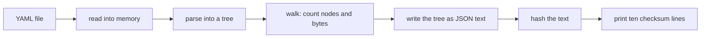

# A YAML tree: yaml-cpp, rapidyaml and Goose

Goose is faster than both libraries and uses less memory. On real Kubernetes YAML of 22 MB and
180 MB, the Goose row is 2.0 to 2.4 times faster than rapidyaml and 20 to 21 times faster than
yaml-cpp. Its peak memory is 2.6 to 3.8 times less than rapidyaml's and about 10 times less than
yaml-cpp's.

The language is not the cause of the win. A C copy of the Goose program, with the same steps and the
same bytes in memory, has the same speed (within 1 to 3%). The win comes from two design choices:

- Each node holds only the bytes it needs.
- The parser reads only a subset of YAML.

Goose makes the first choice the normal way to write the program. In C, the same layout needs
hand-written byte packing.

Numbers: `scripts/run.sh`, in [results/bench-table.md](results/bench-table.md).

## The rows

- **Idiomatic: yaml-cpp** (`c5e6536`), the most used C++ YAML library. Each node is a separate heap
  object with shared ownership. Harness: [baselines/yamlcpp_row.cpp](baselines/yamlcpp_row.cpp).
- **Expert: rapidyaml** (`c42152f`), the fastest known C++ YAML library. It keeps all nodes in one
  array, and its strings point into the input text. Harness:
  [baselines/ryml_row.cpp](baselines/ryml_row.cpp).
- **Goose: [goose/yaml.goose](goose/yaml.goose)**, a new YAML tree written for this study.

Three control rows:

- **C twin** ([baselines/twin.c](baselines/twin.c)): the Goose program written again in C, function
  by function, with the same bytes in memory and no run-time checks.
- **rapidyaml, reserved**: rapidyaml with its node array made large enough before the parse, from its
  own size estimate.
- **C twin with large nodes**: the C twin with each node 144 bytes long, the size of a rapidyaml
  node. Nothing else changes.

## The work

Each row reads the file, builds its tree, and walks the tree once. The walk counts maps, sequences,
scalars, nulls, keys and scalar bytes. It also writes the tree as one JSON line per document, and a
hash of that text is the last checksum line. Each row prints the same ten lines, and the run stops if
one line differs. Every row frees its tree inside the timed run.



## Inputs

All real inputs are public files: every `.yaml` and `.yml` file of three repositories, at fixed
commits. The repositories are kubernetes/kubernetes, prometheus-operator/prometheus-operator and
kubernetes/website.

We kept only the files that three references read the same way: PyYAML, yaml-cpp and rapidyaml. We
kept 8,925 of 8,979 files:

- 35 files were outside the subset or not valid YAML for PyYAML: 22 with errors, 9 with complex keys,
  2 with no document, 1 with an empty document and 1 with a tab.
- yaml-cpp refused 7 files. Six of them are test files with duplicate keys, on purpose.
- rapidyaml refused 5 files and read 7 files differently from PyYAML.

No file in these repositories uses anchors, aliases or tags. The verdicts are in
`results/*-classify.tsv` ([inputs/prep.py](inputs/prep.py)) and
[results/agree-baselines.tsv](results/agree-baselines.tsv) ([inputs/agree.py](inputs/agree.py)).

| size | content | bytes |
|---|---|---:|
| small | the first 271 files | 1,052,331 |
| medium | all 8,925 files | 22,421,093 |
| large | 8 copies of medium | 179,368,744 |

The large input is 180 MB, not 300 MB. yaml-cpp needs about 25 bytes of memory for each byte of
input, and the machine has 7 GB.

[inputs/real.sh](inputs/real.sh) makes all three. It fetches only the YAML files of the three
repositories (71 MB) and joins them with [inputs/corpus.py](inputs/corpus.py). The result has the
same bytes as ours ([inputs/sha256.txt](inputs/sha256.txt)).

A generator, [inputs/gen.py](inputs/gen.py), makes files of the same three sizes with the same shape,
from a seed. Every input comes with the text PyYAML writes for it (`prep.py emit`), which every row
must reproduce.

## The YAML subset

The Goose parser reads block and flow collections, plain scalars, single-quoted and double-quoted
scalars (with all escapes), literal (`|`) and folded (`>`) block scalars, comments and streams of many
documents. It follows PyYAML's rules for line folding and block scalars.

It does not read anchors, aliases, tags, directives or complex keys. It stops with an error if it
finds one. It checks less than a full YAML parser does: some invalid inputs give a result instead of
an error.

The Goose parser gives the same output as PyYAML on all 8,944 files that PyYAML accepts. This
includes the 19 files where yaml-cpp or rapidyaml fail ([results/agree-all.tsv](results/agree-all.tsv)).

## Results

Command: `scripts/run.sh` (it runs `scripts/bench.py`), folded by `scripts/table.py` into
[results/bench-table.md](results/bench-table.md). 1 warm-up and 5 runs per row, in turn. "Spread" is
the range of the 5 runs divided by the median. A process that does nothing takes 0.007 s under the
same tools. How the times were taken: [../machine.md](../machine.md).

| size | row | median | spread | vs Goose | cycles | peak memory |
|---|---|---:|---:|---:|---:|---:|
| small | yaml-cpp | 0.138 s | 0.9% | 9.9x | 0.32 G | 29.5 MB |
| | rapidyaml | 0.024 s | 2.5% | 1.7x | 0.027 G | 14.9 MB |
| | rapidyaml, reserved | 0.021 s | 1.4% | 1.5x | 0.029 G | 10.1 MB |
| | **Goose** | **0.014 s** | 3.6% | | 0.015 G | **4.3 MB** |
| | C twin | 0.014 s | 3.7% | same | 0.015 G | 4.0 MB |
| medium | yaml-cpp | 2.606 s | 3.2% | 20.1x | 6.30 G | 543 MB |
| | rapidyaml | 0.301 s | 2.0% | 2.3x | 0.51 G | 214 MB |
| | rapidyaml, reserved | 0.263 s | 1.1% | 2.0x | 0.55 G | 147 MB |
| | **Goose** | **0.130 s** | 1.9% | | 0.27 G | **56 MB** |
| | C twin | 0.130 s | 1.9% | same | 0.28 G | 56 MB |
| large | yaml-cpp | 20.803 s | 0.8% | 21.0x | 50.6 G | 4,227 MB |
| | rapidyaml | 2.384 s | 0.5% | 2.4x | 4.15 G | 1,596 MB |
| | rapidyaml, reserved | 2.054 s | 0.2% | 2.1x | 4.36 G | 1,151 MB |
| | **Goose** | **0.990 s** | 4.0% | | 2.17 G | **439 MB** |
| | C twin | 0.991 s | 2.0% | same | 2.20 G | 439 MB |

The small times are near the 0.007 s start-up time, so the small ratios are less exact.

- **Goose as one C file** ([results/bench-standalone-table.md](results/bench-standalone-table.md)).
  Goose's suite compiles each program and the Goose run-time as one C file. This gives the same
  times (0.99x to 1.00x).
- **Generated inputs** ([results/bench-gen-table.md](results/bench-gen-table.md)). The result is the
  same: Goose is 1.5x to 2.1x faster than rapidyaml and 9.7x to 18x faster than yaml-cpp, and the C
  twin is the same as Goose. One small rapidyaml run was slow (spread 166%); its median does not
  change.

## Where the time goes

Each row prints the time of each phase to its error output ([results/phases.txt](results/phases.txt),
medium input, milliseconds):

| row | read | parse | walk and write | free the tree | hash |
|---|---:|---:|---:|---:|---:|
| yaml-cpp | 7 | 2,153 | 140 | 239 | 19 |
| rapidyaml | 7 | 207 | 48 | 7 | 18 |
| rapidyaml, reserved | 7 | 172 | 50 | 5 | 18 |
| Goose | 7 | 64 | 28 | 0 | 19 |
| C twin | 6 | 60 | 35 | 0 | 19 |

Profiles: `perf record -F 20000 -e cycles:u` ([results/perf-medium-flat.txt](results/perf-medium-flat.txt)).

- **yaml-cpp** uses 36% of its time in a small regular-expression engine. Its scanner uses that
  engine to find each token, one character at a time. About 13% is in the memory allocator, because
  each node is several heap objects. Freeing the tree takes 0.24 s, more than the whole Goose run.
- **rapidyaml** uses most of its time in its general parser. It reads each line, keeps a state for
  each level, and supports all of YAML. About 8% goes to clearing new nodes. Each node is 144 bytes,
  so the medium tree is 87 MB of nodes. Without the reserve, the node array doubles as it grows, to
  151 MB.
- **Goose** uses 24% of its time to scan plain scalars and 12% to write JSON. Its whole tree, with all
  the scalar text copied into it, is 19 MB.

## What it means

**The language is not the cause.** The C twin and Goose have the same times at all three sizes, and
the same memory. Goose runs 2% to 4% more instructions, because its C keeps some bounds checks (the
compiler removed 2 of 72 index checks). The extra instructions do not show in the time.

**Node size is about 1.4x of the win.** The C twin with 144-byte nodes is 1.41x slower at medium and
1.44x slower at large, and uses 3.5 times more memory
([results/bench-pad-table.md](results/bench-pad-table.md)). Each node is larger, so the parser writes
more memory and the walk reads more cache lines.

**The parser design is the other 1.4x to 1.7x.** Our parser supports only a subset of YAML, and it
checks less. rapidyaml supports all of YAML and checks for errors. Some of rapidyaml's extra time is
the price of that, and a benchmark row must say so.

**Which Goose feature helps.** Two features make the compact tree the easy way to write it:

- A variable-size enum: a null is one byte, and a string is a tag, a length and its bytes, with no gap.
- A 4-byte link to a node in a pool, in place of an 8-byte pointer or an index plus a base address.

Also, nothing is freed one node at a time, so teardown costs nothing. yaml-cpp spends 9% of its run
there.

**Could an expert C programmer do the same?** Yes, as the C twin shows. But the twin needs code that
the Goose program does not have: variable-length integers written and read by hand, child links
copied as raw bytes, and unaligned reads. A C++ programmer with ordinary structs gets something like
the 144-byte node, and pays the 1.4x.

## How this could become a row in Goose's suite

1. `bench/goose/yaml.goose`: `goose/yaml.goose` with the generator at the top in place of the file
   read. About 600 lines.
2. `bench/cpp/yaml.cpp`, three variants: yaml-cpp (idiomatic), rapidyaml reserved (expert), and the C
   twin (expert by hand). The C twin shows that the win is the layout.
3. The libraries. rapidyaml can make one header file (`tools/amalgamate.py`). yaml-cpp has 30 source
   files. The suite would need a small way to fetch a library at a pinned commit and compile it with
   the row, so that nothing from the libraries is committed.
4. One entry in the suite's benchmark list: sizes of about 1 MB, 22 MB and 180 MB of generated YAML,
   and the rows above.
5. The generator, in Goose and C++, as the other benchmarks have. Its output gives the same result as
   the real files.

Rust is not measured. Possible rows are `yaml-rust2` or `saphyr`.

Licenses: Goose is Apache-2.0. yaml-cpp, rapidyaml and its c4core library are MIT.

## What could be done next

- Run the same rows on an x86-64 machine with clang, as Goose's suite does. These numbers are for gcc
  on Arm only.
- Make the parser check errors more strictly, and measure the cost. That makes the comparison with
  rapidyaml fairer.

## Run it

From the repository root:

```bash
bin/build-all yaml                    # yaml-cpp, rapidyaml and all rows
bin/fetch-inputs --size small yaml    # the generated small input, and all three real inputs
yaml/scripts/run.sh small             # verify, time, phases; into .out/yaml/results/
```

`CLASSIFY=1 yaml/inputs/real.sh` runs the classifier and the agreement check again, after the rows
are built.

## Files

| path | what |
|---|---|
| `goose/yaml.goose`, `goose/yaml.c` | the Goose row and its generated C ([goose/GENERATED.md](goose/GENERATED.md)) |
| `baselines/` | the yaml-cpp and rapidyaml harnesses, their shared header, and the C twin |
| `inputs/` | the generator, the classifier and canonical writer, the agreement check, the corpus builder, the shape tool, the sums |
| `scripts/` | `build.sh`, `run.sh`, `bench.py`, `table.py` |
| `results/` | the measured tables and CSV files, phases, profile, input statistics, verdicts per file, build and run logs |
