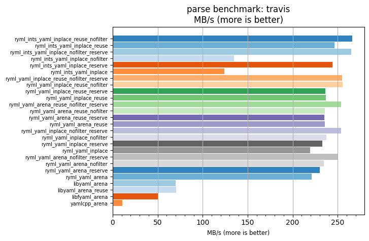
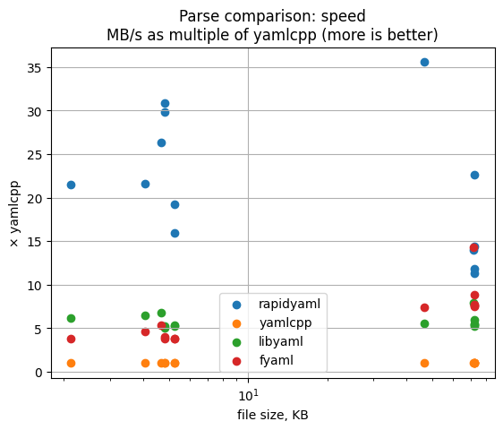
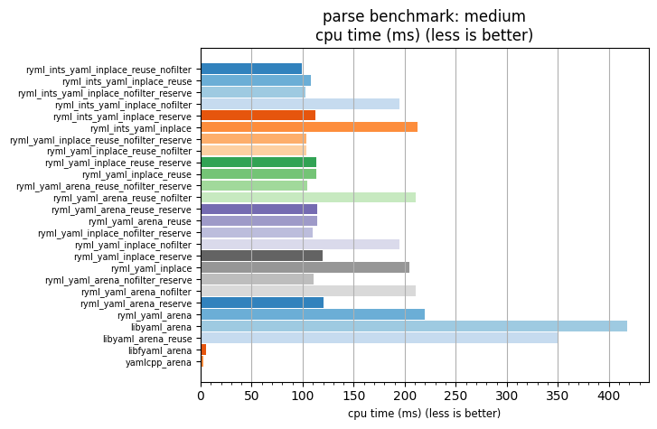
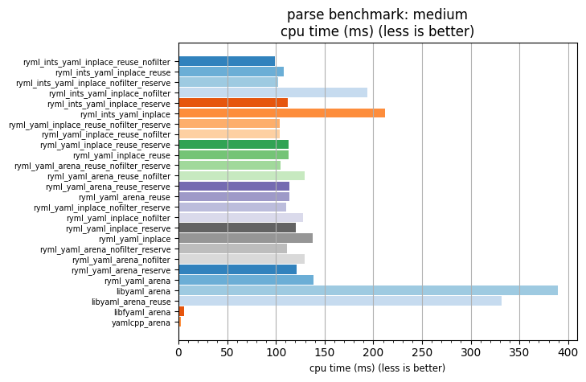
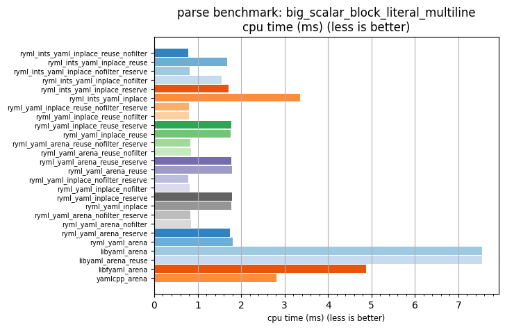
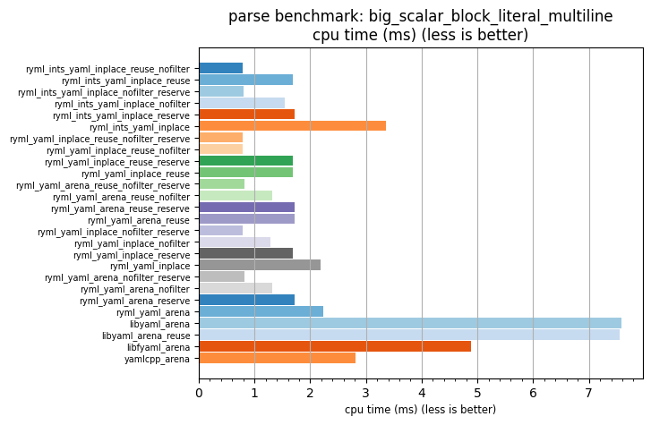
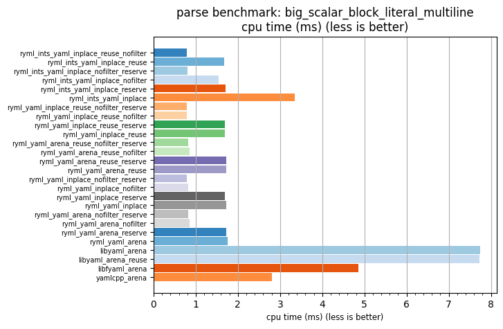

# rapidyaml's own benchmark suite: master against the untouched-tail branch

This page runs the benchmark suite that ships with rapidyaml, in its `bm/` folder, on two trees.
The first tree is rapidyaml `master` at `c42152f2`. The second tree is our branch, which changes how
the node array grows. The branch is `grow-untouched-tail` on
[calpeyser/rapidyaml](https://github.com/calpeyser/rapidyaml/tree/grow-untouched-tail), one commit,
`5e3f3342`. We measured `0507bcdd`. Its library sources are the same as `5e3f3342`. Only one test file
differs. The branch was then rewritten once more as `65807b47` (comments removed, no logic change), and that is the
commit in the upstream PR, [biojppm/rapidyaml#675](https://github.com/biojppm/rapidyaml/pull/675), opened 2026-10-26.
The [yaml evaluation](../README.md) in this repository is where the change came from.

On a large Kubernetes stream parsed into a new tree, the branch takes 0.61 to 0.67 of master's
time. On every other rapidyaml and libyaml row, it takes 0.93 to 1.03 of master's time. Rows that
the change cannot touch move by up to 3% too, and one moves by 11%. Part 5 has the tables, and
[results/final/](results/final/) has every row.

## 1. What the suite is

The suite has two programs:

- `bm_parse` ([bm/bm_parse.cpp](https://github.com/biojppm/rapidyaml/blob/c42152f2/bm/bm_parse.cpp)) reads one file and parses it into a tree, again and again.
- `bm_emit` ([bm/bm_emit.cpp](https://github.com/biojppm/rapidyaml/blob/c42152f2/bm/bm_emit.cpp)) parses the file once, then writes the tree back out as text, again and again.

Each program takes one input file, which the suite calls a case. Each program holds many rows. A row
is one way to do the job: one library, with one set of options. The row names start with `bm_`.

Both programs use [Google Benchmark](https://github.com/google/benchmark). For each row, Google
Benchmark runs the body of a loop many times. It adds iterations until the row has run for at least
0.5 s of CPU time. Then it divides the time by the number of iterations. That gives the time of one
parse or one emit. A row can stop the clock for setup work with `PauseTiming()` and start it again
with `ResumeTiming()`. The suite uses this to keep the copy of the input, and some other setup, out of
the time.

Google Benchmark reports two times: wall time and CPU time. The CPU time includes the time the kernel
spends for the process, for example to give it new memory pages. The plot script and our tables use
the CPU time.

A repetition is one complete run of a program on one case. Times change a little from one run to the
next. So we ran each program 5 times on each case, for each tree, and we report the median: the
middle value of the 5. The master and branch runs of a case ran one after the other, and the first
tree changed from case to case.

The author runs the suite in the GitHub Actions workflow
[benchmarks.yml](https://github.com/biojppm/rapidyaml/blob/c42152f2/.github/workflows/benchmarks.yml).
It configures with `-DRYML_BUILD_BENCHMARKS=ON` and builds three CMake targets in turn:

1. `ryml-bm-build` builds the two programs. It also downloads and builds the other libraries.
2. `ryml-bm-run` runs each program once on each case. Each run writes one json file,
   `bm-results/ryml-bm-<parse|emit>-<case>.json`.
3. `ryml-bm-plot` runs `bm_plot_rapidyaml.py` on each json file, and then once over the whole folder.

The workflow runs each case once, with no repetitions, and keeps the folder as a build artifact. The
charts in rapidyaml's [README](https://github.com/biojppm/rapidyaml/tree/c42152f2#is-it-rapid) are
files of this kind, kept in the
[rapidyaml-data](https://github.com/biojppm/rapidyaml-data/tree/master/bm/results) repository. Those
results also include cases from rapidyaml-data itself, which the build adds when that repository is
in its extern folder. We ran only the cases in rapidyaml's own `bm/cases`, plus the four below.

## 2. The cases

| case | bytes | kind | what it is |
|---|---:|---|---|
| `appveyor.yml` | 2,129 | node-dense | an AppVeyor CI file |
| `travis.yml` | 4,067 | node-dense | a Travis CI file; the case of the charts in rapidyaml's README |
| `compile_commands.json` | 46,826 | JSON | a CMake compile database: a list of objects with long strings |
| `scalar_plain_singleline.yml` | 4,676 | scalar-heavy | plain scalars, one line each |
| `scalar_squot_singleline.yml` | 4,820 | scalar-heavy | single-quoted scalars, one line each |
| `scalar_dquot_singleline.yml` | 4,824 | scalar-heavy | double-quoted scalars, one line each |
| `scalar_block_literal_singleline.yml` | 5,257 | scalar-heavy | literal block scalars, one line each |
| `scalar_block_folded_singleline.yml` | 5,257 | scalar-heavy | folded block scalars, one line each |
| `scalar_plain_multiline.yml` | 72,041 | scalar-heavy | plain scalars over many lines |
| `scalar_dquot_multiline.yml` | 72,181 | scalar-heavy | double-quoted scalars over many lines |
| `scalar_squot_multiline.yml` | 72,273 | scalar-heavy | single-quoted scalars over many lines |
| `scalar_block_literal_multiline.yml` | 72,577 | scalar-heavy | literal block scalars over many lines |
| `scalar_block_folded_multiline.yml` | 72,577 | scalar-heavy | folded block scalars over many lines |
| `medium.yaml` (added) | 22,421,093 | node-dense | 8,925 Kubernetes files as one stream |
| `big_scalar_plain_multiline.yml` (added) | 1,080,675 | scalar-heavy | 15 copies of `scalar_plain_multiline.yml` |
| `big_scalar_dquot_multiline.yml` (added) | 1,082,775 | scalar-heavy | 15 copies of `scalar_dquot_multiline.yml` |
| `big_scalar_block_literal_multiline.yml` (added) | 1,088,715 | scalar-heavy | 15 copies of `scalar_block_literal_multiline.yml` |

The first 13 are rapidyaml's `bm/cases` at `c42152f2`.

Three words describe a case here:

- Node-dense: many small keys and values, so many tree nodes for each byte. A CI file or a Kubernetes
  manifest is node-dense.
- Scalar-heavy: long text values, so few nodes for each byte. The `scalar_*_multiline` files are the
  most scalar-heavy.
- JSON: `compile_commands.json` is the only JSON case. Only on that case does the build also run the
  JSON libraries.

The `scalar_*` files hold one text in five languages (de, en, fr, ru, zh), in one YAML scalar style
for each file. The style is plain, single-quoted, double-quoted, literal block (`|`) or folded block
(`>`). The `singleline` files put each value on one line. The `multiline` files break long values
over many lines.

We added four cases:

- `medium.yaml`, 22 MB: all 8,925 Kubernetes, prometheus-operator and website files of this
  repository's [yaml evaluation](../README.md#inputs), as one stream of documents.
  `bin/fetch-inputs --size small yaml` makes it. Its sha256 is in [../inputs/sha256.txt](../inputs/sha256.txt).
- `big_scalar_block_literal_multiline.yml`, `big_scalar_dquot_multiline.yml` and
  `big_scalar_plain_multiline.yml`, about 1 MB each. Each one holds copies of the `bm/cases` file of
  the same name, one document per copy, up to 1 MiB. They are large and scalar-heavy. That is the
  case where the change costs time. [scripts/cases.sh](scripts/cases.sh) makes them.

Two of the other libraries do not read all of a stream with many documents. The yaml-cpp row calls
`YAML::Load`, which reads only the first document. The libfyaml row stops with an error at line
12,908 of `medium.yaml`, in its 187th document. The suite does not check for that error. So the yaml-cpp row does much less work than the others on the four added cases. The libfyaml row
does the same on `medium.yaml`. Those times are not speeds. They are still a fair noise check, because
they do the same work on both trees.

## 3. The rows

### rapidyaml's rows in `bm_parse`

Each `bm_ryml_*` name is built from parts. Each part names one choice:

| part | what the row does |
|---|---|
| `yaml` or `json` | parse as YAML, or with the JSON parser. The `json` rows run only on the JSON case. |
| `inplace` | parse a writable copy of the input. The tree's strings point into that copy. The copy is made with the clock stopped. |
| `arena` | parse a read-only input. rapidyaml first copies the input into the tree's own memory (its arena), inside the time. |
| `nofilter` | turn off scalar filtering. The parser does not resolve escapes or fold lines; the tree keeps the raw text. |
| `reuse` | parse into the same tree each time. The tree is cleared with the clock stopped. It keeps its node array from the last run, so it does not grow. |
| `reserve` | before the parse, and with the clock stopped, make the node array large enough. The size is 1.5 times `estimate_tree_capacity()` of the input. |

A row with no `reuse` makes a new tree in each iteration. A new tree starts with room for 16 nodes.
When the array is full, the tree doubles it.

One row does not do what its name says. The row `bm_ryml_yaml_arena_reuse_nofilter` reuses the
parser. But it does not give the parser the reused tree, so it parses into a new tree each time
([bm_parse.cpp](https://github.com/biojppm/rapidyaml/blob/c42152f2/bm/bm_parse.cpp#L600-L609)). Its
`_reserve` twin and all other `_reuse` rows do pass the tree. Our tables count this row with the
new-tree rows.

`bm_rymlints_*` rows use a different event handler, `EventHandlerInts`. It writes the parse events
into an array of integers and builds no tree. `bm_rymlints_estimate` times only the size estimate of
that handler.

### The other libraries in `bm_parse`

| row | library | what it does |
|---|---|---|
| `bm_libyaml_arena` | [libyaml](https://github.com/yaml/libyaml) | parses with libyaml, and the suite builds a rapidyaml tree from libyaml's events |
| `bm_libyaml_arena_reuse` | libyaml | the same, into a reused tree |
| `bm_libfyaml_arena` | [libfyaml](https://github.com/pantoniou/libfyaml) | builds and frees a libfyaml document |
| `bm_yamlcpp_arena` | [yaml-cpp](https://github.com/jbeder/yaml-cpp) | `YAML::Load` into yaml-cpp nodes |
| `bm_rapidjson_arena`, `_inplace` | [RapidJSON](https://github.com/Tencent/rapidjson) | parse into a RapidJSON document |
| `bm_sajson_arena`, `_inplace` | [sajson](https://github.com/chadaustin/sajson) | parse into a sajson document |
| `bm_jsoncpp_arena` | [JsonCpp](https://github.com/open-source-parsers/jsoncpp) | parse into a `Json::Value` |
| `bm_nlohmann_arena` | [nlohmann/json](https://github.com/nlohmann/json) | parse into an `nlohmann::json` |

These rows are there to compare rapidyaml with other libraries. The charts give each row's speed as
a multiple of yaml-cpp's speed.

### The rows in `bm_emit`

Each emit row parses the case once, before the clock starts. The loop only writes text.

| row | what it does |
|---|---|
| `bm_ryml_yaml_str`, `bm_ryml_json_str` | write YAML or JSON into a `std::string` |
| `..._str_reserve` | the same, into a string that already has room for twice the input size |
| `..._ostream` | write into a `std::ostringstream` |
| `..._ofstream` | write into a `std::ofstream` on a temporary file |
| `..._file` | write into a `FILE*` |
| `..._str_file` | write into a string, then write the string to a `FILE*` |
| `bm_fyaml_str`, `_str_reserve`, `_ostream` | libfyaml's emitter |
| `bm_yamlcpp` | yaml-cpp's emitter |
| `bm_rapidjson`, `bm_jsoncpp`, `bm_nlohmann` | the JSON libraries' writers (JSON case only) |

### Which rows the change can touch

The change is in rapidyaml's `Tree`, in the code that grows and reserves the node array, and in
`estimate_tree_capacity()`. So:

- The `bm_ryml_*` parse rows that make a new tree use the changed code inside the time.
- The `_reuse` rows use a tree that is already large. Inside the time, they claim nodes from it and
  never grow it.
- The `_reserve` rows call `reserve()` with the clock stopped. The change moves work out of
  `reserve()`, so some of that work now happens after the clock starts. Part 4 shows this.
- The libyaml rows build a rapidyaml tree too, so they use the changed growth code. They do not
  reserve from the source, because they do not call rapidyaml's parse functions.
- The `bm_rymlints_*` rows build no tree. The change cannot touch them.
- No emit row can be touched: the tree is built before the clock starts.
- libfyaml, yaml-cpp and the JSON libraries do not use rapidyaml at all.

The rows that the change cannot touch are the noise floor. They run the same code on both trees. If
they move between the two trees, that movement is noise from the machine.

## 4. What `bm_plot_rapidyaml.py` draws

`bm_plot_rapidyaml.py` reads the json files and draws two kinds of chart with matplotlib. It
also writes an interactive HTML page (Bokeh), a markdown page and a text table for each chart. We
keep the PNG charts and the text tables in [plots/](plots/).

**The bar charts: one case, every row.** The script draws two bar charts for each case and program:

- `ryml-bm-<parse|emit>-<case>-mega_bytes_per_second.png`: one horizontal bar for each row. The bar
  length is the speed in MB of input per second. A longer bar is faster.
- `ryml-bm-<parse|emit>-<case>-cpu_time_ms.png`: the same rows, with the CPU time of one parse or one
  emit in milliseconds. A shorter bar is faster.

The rows are in the order the program ran them, top to bottom. The colors only separate the bars.
They do not mean anything. The text table `ryml-bm-<parse|emit>-<case>.txt` has the same numbers. It
also gives each row as a multiple of yaml-cpp, and as a percentage of yaml-cpp.

Here is master's parse chart for `travis.yml`, the case in rapidyaml's README:



To read it, compare bars of the same library first. The `_reserve` and `_reuse` rows are faster than
the plain rows of the same kind. They do not grow the node array while the clock runs. The
fastest row builds no tree: `ryml_ints_yaml_inplace_reuse_nofilter`. At the bottom are libyaml,
libfyaml and yaml-cpp, at about 1/3, 1/4 and 1/20 of rapidyaml's speed.

**The scatter charts: every case, one row per library.** After the bar charts, the script runs once
more over the whole folder. It draws one point per case for each library. The x axis is the file
size in KB, on a log scale. There are four charts per program:

- `-mega_bytes_per_second-vals`: the speed in MB/s.
- `-mega_bytes_per_second-rel`: the speed as a multiple of yaml-cpp's speed on the same case.
- `-cpu_time_ms-vals`: the CPU time, on a log scale.
- `-cpu_time_ms-rel`: the CPU time as a multiple of yaml-cpp's time.

The script picks one row for each library:

| program | rapidyaml | yaml-cpp | libyaml | libfyaml |
|---|---|---|---|---|
| parse | `bm_ryml_yaml_inplace_reuse_reserve` | `bm_yamlcpp_arena` | `bm_libyaml_arena_reuse` | `bm_libfyaml_arena` |
| emit | `bm_ryml_yaml_str_reserve` | `bm_yamlcpp` | - | `bm_fyaml_str_reserve` |

The rapidyaml parse point is a `_reuse` row. Its tree is already large before the clock starts, so
the change cannot move this point. Part 5 shows this.

We drew the scatter charts over rapidyaml's 13 cases only. On the four added streams, yaml-cpp, and
libfyaml on `medium.yaml`, read only part of the input, as part 2 says. Their points would be far off the chart.



On master, rapidyaml parses these 13 cases 11 to 36 times as fast as yaml-cpp.

**Two result sets in one chart.** The script takes more than one json file for one case. It then
writes one table for each file. But it saves each file's PNG under the same name, so only the last
one is kept. Only the HTML page shows them side by side. So we drew the full set once for each
tree, from the same script. Part 5 puts the two trees next to each other.

Here are master and the branch side by side, CPU time, for one node-dense case and one
scalar-heavy case. The x axes have their own scales, so read the numbers on the axis.

| `medium.yaml`, master | `medium.yaml`, branch |
|---|---|
|  |  |

On `medium.yaml`, five `bm_ryml` bars get shorter on the branch: `yaml_inplace`, `yaml_arena`, their
`_nofilter` forms, and `yaml_arena_reuse_nofilter`. These are the rows that parse into a new tree with
no reserve. On master they take about 200 ms. On the branch they take about 130 ms, close to the
`_reserve` rows. The two libyaml bars get about 6% shorter. Every other bar keeps its length.

| `big_scalar_block_literal_multiline.yml`, master | the branch before the fixes (`ebf17e15`) | the branch |
|---|---|---|
|  |  |  |

On the 1 MB scalar stream, the before-fixes chart has five longer bars: the same new-tree rows. The
branch chart has the same bars as master. The scatter charts of the two trees are the same within 2%,
because the rapidyaml point there is a `_reuse` row: [master](plots/master/ryml-bm-parse-scatter-mega_bytes_per_second-rel.png),
[branch](plots/branch/ryml-bm-parse-scatter-mega_bytes_per_second-rel.png).

All charts: [plots/master/](plots/master/) and [plots/branch/](plots/branch/).

## 5. Master against the branch

Each ratio below is the branch's median CPU time divided by master's: below 1 means the branch is
faster. Both trees ran on one machine, in turns, 5 times each ([machine.md](machine.md)). Over all
rows, half of the 5-run spreads are under 0.7%, and 90% are under 1.9%.

The full tables:

- [results/final/summary.md](results/final/summary.md): one geometric mean per case and kind of row.
- [results/final/compare-parse.md](results/final/compare-parse.md) and
  [compare-emit.md](results/final/compare-emit.md): every row, with both medians and both spreads.
- [results/final/compare.csv](results/final/compare.csv) and [runs.csv](results/final/runs.csv):
  the same, and every repetition, as data.

The branch had one earlier commit, `ebf17e15`. It lacked two fixes, which part 5.4 and part 5.5
explain. Its run is in [results/before-fixes/](results/before-fixes/), with the same layout. We show
it in the "before the fixes" columns.

### 5.1 Faster: a large node-dense document into a new tree

`medium.yaml`, 22 MB, `bm_parse`, the rows that parse into a new tree with no reserve:

| row | master ms | branch ms | branch / master | before the fixes |
|---|---:|---:|---:|---:|
| `bm_ryml_yaml_inplace` | 204.6 | 137.9 | 0.674 | 0.727 |
| `bm_ryml_yaml_inplace_nofilter` | 194.4 | 128.0 | 0.658 | 0.715 |
| `bm_ryml_yaml_arena` | 219.7 | 138.7 | 0.631 | 0.679 |
| `bm_ryml_yaml_arena_nofilter` | 211.0 | 129.4 | 0.613 | 0.659 |
| `bm_ryml_yaml_arena_reuse_nofilter` | 210.5 | 129.4 | 0.615 | 0.659 |
| `bm_libyaml_arena` | 418.2 | 389.7 | 0.932 | 0.933 |
| `bm_libyaml_arena_reuse` | 350.0 | 331.8 | 0.948 | 0.952 |

On master, a new tree starts with room for 16 nodes and doubles when it is full. Each doubling writes
every new node slot at once, so the parse pays for the memory of nodes it never uses. On the branch,
the parse reads a sample of the source first and sizes the node array once. Also, the branch writes
a node slot only when a node goes in it.

The libyaml rows build a rapidyaml tree node by node, with no size estimate. They get only the second
part, so they gain less.

### 5.2 No change: the small cases

All `bm_ryml_*` rows of `bm_parse`, per case, for rapidyaml's 13 cases of 2 KB to 73 KB:

| case | rows | geometric mean | fastest row | slowest row |
|---|---:|---:|---:|---:|
| `appveyor.yml` | 16 | 1.001 | 0.972 | 1.017 |
| `travis.yml` | 16 | 0.992 | 0.973 | 1.002 |
| `compile_commands.json` | 32 | 0.995 | 0.971 | 1.010 |
| `scalar_plain_singleline.yml` | 16 | 0.991 | 0.968 | 1.001 |
| `scalar_squot_singleline.yml` | 16 | 0.984 | 0.952 | 1.002 |
| `scalar_dquot_singleline.yml` | 16 | 0.989 | 0.956 | 1.004 |
| `scalar_block_literal_singleline.yml` | 16 | 0.984 | 0.951 | 0.996 |
| `scalar_block_folded_singleline.yml` | 16 | 0.983 | 0.948 | 1.000 |
| `scalar_plain_multiline.yml` | 16 | 1.001 | 0.999 | 1.003 |
| `scalar_squot_multiline.yml` | 16 | 1.001 | 0.990 | 1.023 |
| `scalar_dquot_multiline.yml` | 16 | 0.995 | 0.990 | 1.002 |
| `scalar_block_literal_multiline.yml` | 16 | 0.983 | 0.944 | 0.999 |
| `scalar_block_folded_multiline.yml` | 16 | 0.997 | 0.990 | 1.001 |
| all 13 | 224 | 0.992 | 0.944 | 1.023 |

These sources are under 128 KiB. Below that size the parser does not size the tree from the source.
So only the second part runs: a doubling no longer writes the new half. On the 2 to 5 KB cases, the
new-tree rows are 2 to 4% faster ([summary.md](results/final/summary.md), first column). The rest is
within noise.

### 5.3 No change: a reused tree

`medium.yaml`, the rows that parse into a reused tree:

| row | master ms | branch ms | branch / master | before the fixes |
|---|---:|---:|---:|---:|
| `bm_ryml_yaml_inplace_reuse` | 113.2 | 112.9 | 0.997 | 0.998 |
| `bm_ryml_yaml_inplace_reuse_nofilter` | 104.1 | 103.7 | 0.997 | 0.998 |
| `bm_ryml_yaml_inplace_reuse_reserve` | 113.4 | 113.0 | 0.997 | 0.996 |
| `bm_ryml_yaml_inplace_reuse_nofilter_reserve` | 103.9 | 103.7 | 0.998 | 1.001 |
| `bm_ryml_yaml_arena_reuse` | 114.0 | 113.8 | 0.999 | 0.998 |
| `bm_ryml_yaml_arena_reuse_reserve` | 114.1 | 114.0 | 0.999 | 0.997 |
| `bm_ryml_yaml_arena_reuse_nofilter_reserve` | 104.9 | 104.8 | 0.999 | 0.997 |

A reused tree already has room for every node before the clock starts. The parse never grows it, so
the changed code does not run inside the time.

On the 72 KB and 1 MB block-literal cases, the `_reuse` rows without `nofilter` are 2 to 6% faster on
the branch, in both runs. We do not know why. The same rows on the other cases do not move.

### 5.4 Was slower, now even: the `_reserve` rows

`medium.yaml`, the rows that reserve with the clock stopped, then parse into that new tree:

| row | master ms | branch ms | branch / master | before the fixes |
|---|---:|---:|---:|---:|
| `bm_ryml_yaml_inplace_reserve` | 119.4 | 120.2 | 1.006 | 1.156 |
| `bm_ryml_yaml_inplace_nofilter_reserve` | 109.5 | 110.5 | 1.009 | 1.163 |
| `bm_ryml_yaml_arena_reserve` | 120.2 | 121.4 | 1.010 | 1.149 |
| `bm_ryml_yaml_arena_nofilter_reserve` | 110.7 | 111.6 | 1.008 | 1.165 |

On master, `reserve()` writes every node slot, so all the new memory pages are in place before the
clock starts. Before the fixes, the branch's `reserve()` wrote nothing. So the parse touched each
new page for the first time inside the clock. The kernel's work to supply those pages moved into
the time. The fix makes `reserve()` touch every page again, as master does. So that work is back
outside the clock.

With the reserve inside the clock ([scripts/reserve_then_parse.cpp](scripts/reserve_then_parse.cpp),
`medium.yaml`, a new tree, reserve, parse, median of 21, two rounds):

| tree | reserve ms | reserve + parse ms |
|---|---:|---:|
| master | 50.7-50.8 | 164.1-164.4 |
| branch | 35.5-35.9 | 148.9-149.2 |
| branch before the fixes | 0.02 | 135.1-135.3 |

[results/final/reserve-then-parse.txt](results/final/reserve-then-parse.txt),
[results/before-fixes/reserve-then-parse.txt](results/before-fixes/reserve-then-parse.txt).

The benchmark reserves 1.5 times the estimate, about twice the nodes the parse uses. The branch's
`reserve()` now touches all of those pages, also the ones that the parse never uses. That is why the
branch takes 14 ms more than before the fixes. It is still 9% faster than master.

### 5.5 Was slower, now even: large scalar-heavy sources

The three 1 MB streams of multi-line scalars, the rows that parse into a new tree with no reserve:

| case | row | master ms | branch ms | branch / master | before the fixes |
|---|---|---:|---:|---:|---:|
| block literal | `bm_ryml_yaml_inplace` | 1.78 | 1.72 | 0.966 | 1.229 |
| block literal | `bm_ryml_yaml_arena` | 1.81 | 1.75 | 0.969 | 1.251 |
| block literal | `bm_ryml_yaml_inplace_nofilter` | 0.81 | 0.82 | 1.018 | 1.590 |
| block literal | `bm_ryml_yaml_arena_nofilter` | 0.84 | 0.85 | 1.013 | 1.571 |
| double-quoted | `bm_ryml_yaml_inplace` | 4.40 | 4.38 | 0.996 | 1.103 |
| double-quoted | `bm_ryml_yaml_arena` | 4.45 | 4.41 | 0.991 | 1.106 |
| double-quoted | `bm_ryml_yaml_inplace_nofilter` | 1.42 | 1.43 | 1.006 | 1.333 |
| double-quoted | `bm_ryml_yaml_arena_nofilter` | 1.45 | 1.46 | 1.002 | 1.329 |
| plain | `bm_ryml_yaml_inplace` | 5.22 | 5.22 | 1.001 | 1.088 |
| plain | `bm_ryml_yaml_arena` | 5.25 | 5.26 | 1.000 | 1.088 |
| plain | `bm_ryml_yaml_inplace_nofilter` | 3.06 | 3.07 | 1.004 | 1.152 |
| plain | `bm_ryml_yaml_arena_nofilter` | 3.09 | 3.11 | 1.004 | 1.150 |

Before the fixes, the parser counted the possible nodes in every byte of a source of 128 KiB or more.
A scalar-heavy source has few nodes for its size, so the count cost more time than the sizing saved.
The cost is largest on the `nofilter` rows, because their parse is the cheapest. The fix counts four
windows of 16 KiB and scales the count to the whole source. So the count costs the same small time
for any source size.

### The noise floor

| rows | what they run | branch / master, every row |
|---|---|---|
| `bm_rymlints_*`, `bm_parse`, 109 rows | rapidyaml's parser with no tree | 0.991 to 1.010 |
| libfyaml, yaml-cpp and the JSON libraries, `bm_parse`, 40 rows | no rapidyaml code | 0.986 to 1.012, and 1.107 |
| `bm_ryml_*`, `bm_emit`, 108 rows | rapidyaml's emitter; the tree is built before the clock | 0.985 to 1.028 |
| libfyaml, yaml-cpp and the JSON libraries, `bm_emit`, 71 rows | no rapidyaml code | 0.968 to 1.026 |

These rows run the same code on both trees. Even so, they move by up to 3%. The 1.107 is
`bm_nlohmann_arena` on `compile_commands.json`. It is 11% slower on the branch in both runs, with
spreads under 0.5%. The branch and master are two different program files. So the same code can lie
at different addresses, and that can change its speed. The libfyaml emit rows on the multi-line cases
are 3% faster in this run and 3% slower in the before-fixes run. So a move of 3% or less on one row
is not a result.

### Against the earlier reading

The operator read an earlier `bm_parse` run of `ebf17e15`, on another machine of the same type.
Our before-fixes run agrees with it:

| rows | earlier reading | our before-fixes run |
|---|---|---|
| `medium.yaml`, plain new-tree rows | 0.64 to 0.71 | 0.66 to 0.73 |
| `medium.yaml`, `_reuse` rows | 0.995 to 1.000 | 0.996 to 1.001 |
| `medium.yaml`, `_reserve` new-tree rows | 1.15 to 1.17 | 1.149 to 1.165 |
| reserve inside the clock, master against branch | 165.6 ms against 135.5 ms | 164.8-165.4 ms against 135.1-135.3 ms |
| small cases, geometric mean per case | 0.985 to 1.027 | 0.98 to 1.01 |
| 1 MB of multi-line scalars, `bm_ryml_yaml_inplace` | 1.09 to 1.25 | 1.09 to 1.23 |
| 1 MB of multi-line scalars, `nofilter` rows | not measured | 1.15 to 1.59 |

Our 1 MB files are not quite the files of that run. Ours put each copy in its own document, after a
`---` line. That run's files put the copies end to end as one map.

## 6. How to repeat it

The machine and the versions are in [machine.md](machine.md). You need gcc and g++, git, Python 3,
CMake 3.12 or newer and Ninja, on the `PATH`. The rapidyaml build downloads Google Benchmark and the other libraries.

```bash
git clone https://github.com/calpeyser/goose-evaluations && cd goose-evaluations
bin/build-all yaml                                  # the Python venv that fetch-inputs uses (about 3 min)
bin/fetch-inputs --size small yaml                  # makes .inputs/yaml/real/medium.yaml
cd yaml/rapidyaml-suite
scripts/build.sh                                    # clone rapidyaml, two worktrees, build both (about 10 min each on 2 cores)
scripts/cases.sh                                    # the 17 cases, in .out/rapidyaml-suite/cases
RUN=final scripts/run.sh                            # 5 repetitions, master and branch in turns (about 100 min)
python3 scripts/median.py ../../.out/rapidyaml-suite/runs/final results/final
python3 scripts/compare.py results/final/runs.csv ../../.out/rapidyaml-suite/cases results/final
RUN=final scripts/plot.sh                           # the author's charts, for each tree
scripts/reserve.sh                                  # the _reserve row with the reserve inside the clock
```

In file and folder names, `grow` is the branch. Set `BRANCH_COMMIT=<sha>` to build and run another
branch commit. `RYML`, `WT` and `WORK` move the clone, the worktrees and the work folder.
[scripts/env.sh](scripts/env.sh) lists them.

What each script does:

| script | what |
|---|---|
| [env.sh](scripts/env.sh) | the paths and commits that every script uses |
| [build.sh](scripts/build.sh) | the rapidyaml clone, the two worktrees, the plot script's Python packages, and the `ryml-bm-build` target in each tree |
| [cases.sh](scripts/cases.sh) | copies the 13 cases and `medium.yaml`, and makes the three 1 MB scalar streams |
| [run.sh](scripts/run.sh) | runs `bm_parse` and `bm_emit` on each case, as the `ryml-bm-run` target does, for each tree and repetition |
| [median.py](scripts/median.py) | keeps, for each row, the repetition with the median CPU time, in the layout the plot script reads |
| [compare.py](scripts/compare.py) | the tables of part 5 |
| [plot.sh](scripts/plot.sh) | runs `bm_plot_rapidyaml.py` per case and then `scatter`, as the `ryml-bm-plot` target does |
| [reserve.sh](scripts/reserve.sh) | builds and runs [reserve_then_parse.cpp](scripts/reserve_then_parse.cpp) on each tree |

Use one machine for both trees, and run nothing else on it. Times from two machines do not compare,
even of the same type.
